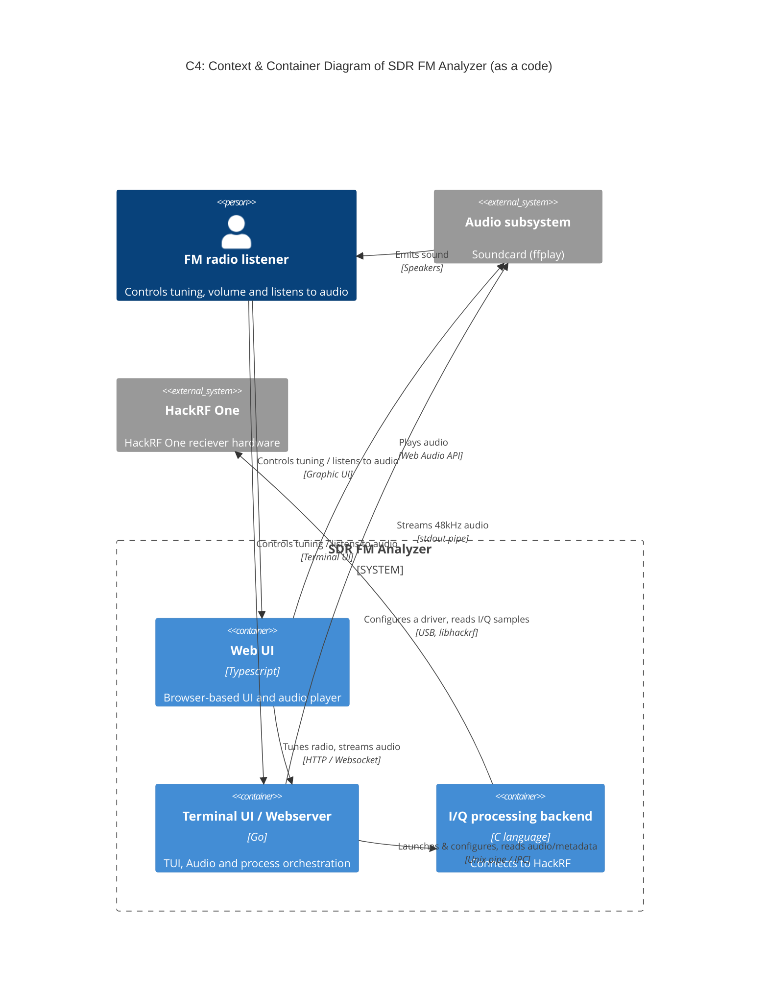
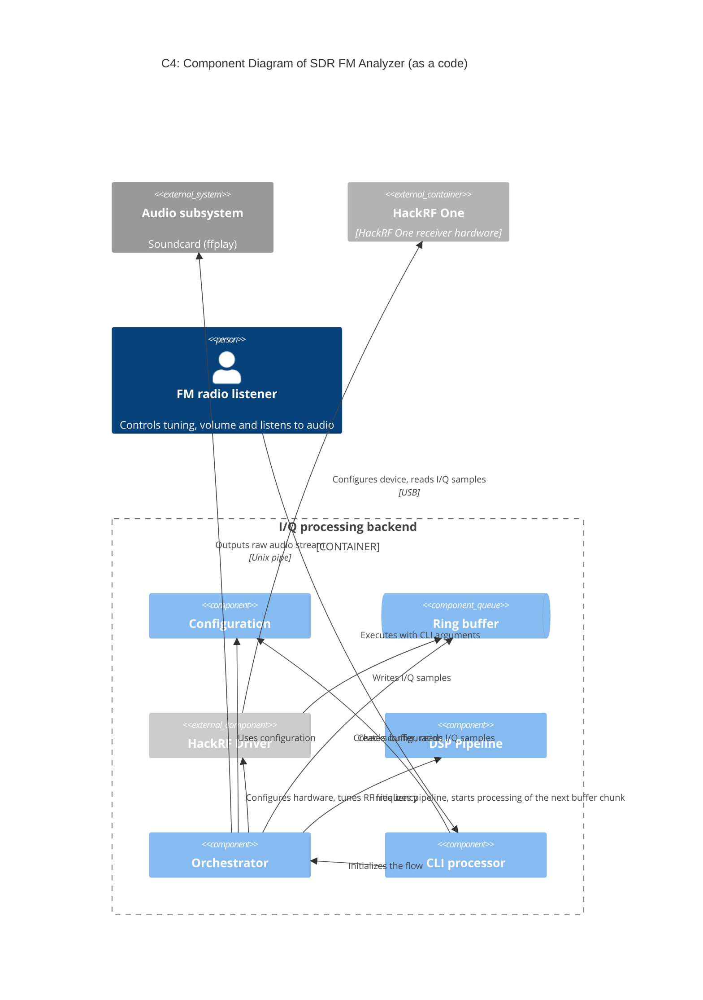

> This document is non-complete and in process of creation

# Introduction and Goals

## Background

With rising of computation power over the last two decades and wide accessability to SIMD architecture in consumer devices,
different engineering approaches have moved from hardware to software. One good example is radio payload
processing on software side, called Software Defined Radio. Instead of modelling hardware circuit, testing, producing,
which are relatively slow processes, building the same logic on software side brings many benefits:

* Fast iteration in research tasks in radio domain
* Fast feedback loop when prototyping a new type of service, device or algorithm 
* Possibility to apply well established Digital Signal Processing algorithms to radio domain  
* Simulate different corner and edge cases while doing verification and validation 

This project uses HackRF One as affordable consumer-level SDR hardware.

## Goals of this project

The are several motivations while working on this project:

- Hand-on learning of Software Defined Radio
    - Signal modulation and de-modulation
    - FM radio station bandwidth layout
- Study fundamentals of Digital Signal Processing approaches and algorithms
- Work with hardware
- Back to C language after pause of a decade
- Form a roadmap in further development in SDR and DSP

## Requirements

### Functional requirements

| Requirement | Title | Description | Importance | Status |
|-|-|-|-|-|
| FR-1 | A user can listen to FM radio station | This is the very basic functionality that requires end-to-end FM signal capturing and decoding | MANDATORY | Implemented |
| FR-2 | A user can tune to FM station of interest |  | MANDATORY | Implemented |
| FR-3 | A user can record an FM station to audio file | To be able to play it later  | OPTIONAL | Implemented |
| FR-4 | A user can tune volume of FM station | | OPTIONAL | NOT implemented |
| FR-5 | A user can see metadata of FM station | FM broadcast stations transmit metadata called RDS (Radio Data System) such as song titles, artist names, and station callsigns  | MANDATORY | NOT implemented |
| FR-6 | A user can explore a list of FM stations available nearby |  | OPTIONAL | NOT implemented |
| FR-7 | Both mono and stereo FM stations should be supported | | MANDATORY | Partly implemented |
| FR-8 | Stereo FM station should be converted into stereo audio | | MANDATORY | NOT implemented |

### Non-functional requirements

| Requirement | Title | Description | Importance | Status |
|-|-|-|-|-|
| NFR-1 | It should be possible for a user to use console and/or Web UIs| | MANDATORY | Partly implemented |

# Architecture Constraints

- Do not use any existing DSP framwork or library, to understand things from the ground
- Do not use any abstraction layer over SDRs, like gr-osmosdr
- The target operation system is Linux
- Use HackRF One hardware as the only available
- Use C languge to work with HackRF driver directly, without any bindings and additional layers

# Context and Scope

## Domain context

The SDR FM Analyzer captures radio frequency broadcasts, demodulates commercial FM radio stations and delivers real-time audio and metadata to listeners.

| Actor | Input to System | Output from System | Domain Responsibility |
|:---|--|--|--|
| FM Radio Listener | Tuning frequency, gain levels and volume | Decoded audio (music/voice), RDS metadata (song title, station callsign) | Interacts with UI, provides configuration, listens to broadcasts |
| FM Radio Broadcasters | Over-the-air RF electromagnetic waves (87.5 – 109.0 MHz) | None | Transmit FM multiplex (MPX) signals (Mono, Stereo, RDS) |
| OS Audio Subsystem | None | 48 kHz PCM audio stream | Converts digital audio samples into acoustic sound waves |

## Technical Context

| Interface | Channel type| Protocol | Data Format / Payload |
|:---|--|--|--|
| HackRF One | USB 2.0 peripheral | `libhackrf` driver API | Interleaved 8-bit signed quadrature pairs (`int8_t` I/Q at 8-20 MSPS) |
| Audio Subsystem (ffplay / ALSA) | Linux OS Pipe (`stdout`) | Unix stream pipe, 64Kb buffer | 48 kHz, 16-bit signed little-endian PCM (`int16_t` mono/stereo) |
| Terminal UI (Go) | Host terminal | ANSI / VT100, `stdin/stderr` | Text commands, telemetry strings |
| Web UI (Browser) | Local network / loopback | HTTP + WebSockets | HTML/JS assets, JSON control messages, Web Audio streams |

#### Handling of high sample rate in software

Processing of raw radio high frequency signal, like 2.4 or 5 GHz, is computationally
impossible operation for even modern CPUs that also work at the same frequency around
3 GHz and it exceed USB 2.0 throughput. For that reason, SDR hardware downconverts the
signal of interest to complex baseband of 0 Hz without losing the information it carries. 
The software receives only the bandwidth of interest (e.g. 2–10 MSPS over USB 2.0),
which is easily processed by a standard CPU.

#### HackRF One center spike

HackRF One should be tuned a bit left or right from frequency of interest due to the high 
signal spike right at the center of bandwidth it captures.
This phenomenon is called DC offset and it is caused by Local Oscillator (LO) leakage.
To overcome this, the project uses a techniqe called Offset Tuning (Off-tuning) when hardware
is tuned at e.g. 250 KHz away, and the software shifts it back digitally using a complex mixer.

#### FM bandwidh layout

FM Multiplex (MPX) baseband spectrum contains different types of signals - audio and metadata - that should be
demodulated by applying different alorithms. Besides that, audio information is split into two
ranges within the FM bandwidth - mono and stereo. While mono signal is self-contained
and can be demodulated independently from anything else, stereo signal is mathematically
dependent on mono signal and should be processed strictly in-phase.
The FM spectrum layout:
* Mono (L + R): Baseband audio (30 Hz - 15 kHz)
* Pilot tone: 19 kHz reference phase for stereo signal recovery
* Stereo (L - R): DSB-SC modulated around 38 kHz (2 × 19 kHz)
* Matrix decoding: Left and Right are extracted via (L + R) + (L - R) = 2L and (L + R) - (L - R) = 2R

# Solution Strategy

1. Introduce and decouple the I/Q Processing Backend from frontend user interfaces. This also allows to support multiple frontends written in different technologies.
1. The I/Q Processing Backend receives initial configuration - like FM
frequency - via CLI parameters. This allows to use and test it in isolation from other components. This does not mean that this is the only way to configure the backend.
Future implementation could support re-configuration in runtime via `STDIN`.
1. The I/Q processing backend outputs a stream of audio data via `STDOUT`. This allows to
use a standard Unix pipe to route this data to any 3rd party program that supports
audio playback or just write it into a file. This approach also moves audio device playback and driver complexity outside the core DSP binary, keeping the backend focused on signal processing.
1. Use Ring Buffer to allow asynchronous data transfer from HackRF to the I/Q processing backend.
1. Downsample and downconvert data step-by-step to (a) lower the CPU usage, (b) support receiving wide sample rate range from 8 MSPS to 20 MSPS, (c) run different DSP algorithms at the most suitable sample rate.
1. Split DSP pipeline into modules: to apply asynchronous and decoupled data processing to allow data handling at different rates and allow functional scaling to cover new requirements without refactoring. This also allows to selectively activate / deactivate
some of them in runtime as per configuration.

# Building Block View

The following table lists the external systems and internal containers that comprise the SDR FM Analyzer:

| Name | External / Internal | Hardware / Software | Description |
| :--- | :--- | :--- | :--- |
| I/Q Processing Backend | Internal | Software | C binary. Interfaces with HackRF One via `libhackrf`, consumes raw I/Q samples, executes the DSP pipeline, and streams decoded PCM audio to `stdout`. |
| Terminal UI / Webserver | Internal | Software | Go application. Supervises the C backend process, provides a terminal UI (TUI), and hosts the HTTP/WebSocket bridge for browser clients. |
| Web UI | Internal | Software | TypeScript/Browser application. Allows the user to tune frequencies, adjust volume, view RDS metadata, and play audio directly in the browser. |
| HackRF One | External | Hardware | Half-duplex SDR transceiver. Captures radio frequency signals (1 MHz – 6 GHz) and streams raw I/Q baseband pairs over USB 2.0. |
| Audio Subsystem | External | Software / Hardware | Host soundcard / audio player (e.g. `ffplay`, ALSA, PulseAudio) that receives PCM audio streams from pipes and drives physical speakers. |

## Context & Container Diagram

Notice: Mermaid diagram renders the PlantUML C4 extension poorly

## Component diagram

The following table details the internal components of the I/Q Processing Backend:

| Component | Type | Description |
| :--- | :--- | :--- |
| CLI Processor | Software module | Parses command-line arguments (target FM frequency, LNA/VGA gains, output options) and displays help text. |
| Configuration | Data structure | Encapsulates immutable runtime configuration passed from the CLI to initialize hardware and DSP stages. |
| HackRF Driver Wrapper | External driver (`libhackrf`) | Initializes the USB device, configures hardware registers (tuner frequency, gains), and receives streaming I/Q callbacks. |
| Ring Buffer | Concurrency queue | Lock-free Single-Producer Single-Consumer (SPSC) circular buffer with C11 atomics. Decouples high-priority USB transfers from DSP processing. |
| DSP Pipeline | Core logic | Performs frequency mixing (off-tuning correction), decimation, FM polar discrimination, de-emphasis, and audio resampling. |
| Orchestrator | Process coordinator | Manages application lifecycle, drives the consumer loop reading from the ring buffer, invokes DSP blocks, and writes PCM frames to `stdout`. |

Notice: Mermaid diagram renders the PlantUML C4 extension poorly

# Cross-cutting Concepts

* The only supported language is English

# Quality Requirements

### QR-1: DSP pipeline should work smoothly on average laptop/desktop hadrware
* Latency: real-time audio playback latency is < 200 ms buffer delay
* Resource limits: CPU utilization < 30% on a standard 2-core x86_64 laptop at 2.0 MSPS I/Q input rate
* Robustness: Zero audio glitches under steady-state operation

TODO: add testable scenarios

# Risks and Technical Debts

The initial prototype has revealed a number of risks that should be addressed or minimized in the final solution.

| Risk | Severity | Description | Mitigation
|--|--|--|--|
| Ring buffer overflow | Low | If DSP part is slow compared to HackRF raw I/Q transfering speed, the buffer will be full. This sould not lead to a buffer overflow problem | Log warning, discard oldest samples, reproduce with unit tests
| I/Q data loss due to a Unix pipe backpressure| High | When consuming party is slow (e.g. audio output), it can not cosume data at the same speed as HackRF produces and DSP processes it, leading to a full Linux kernel pipe 64 Kb buffer with stopping data transferring | Consuming party should work fast and be configured properly. The I/Q backend could support non-blocking writes.
| Lack of CPU computational resources or data transfering speed | Medium | | Use performance tests and log execution over time to be able to visually assess the performance
| Desynchronization of different algorithms | High | Different algorythms in DSP pipline require different decimation, work against different RF frequencies and use different demodulation technics (e.g. sound vs metadata) | This should be part of the technical design. Use intergation tests with decent number of scenarious.

