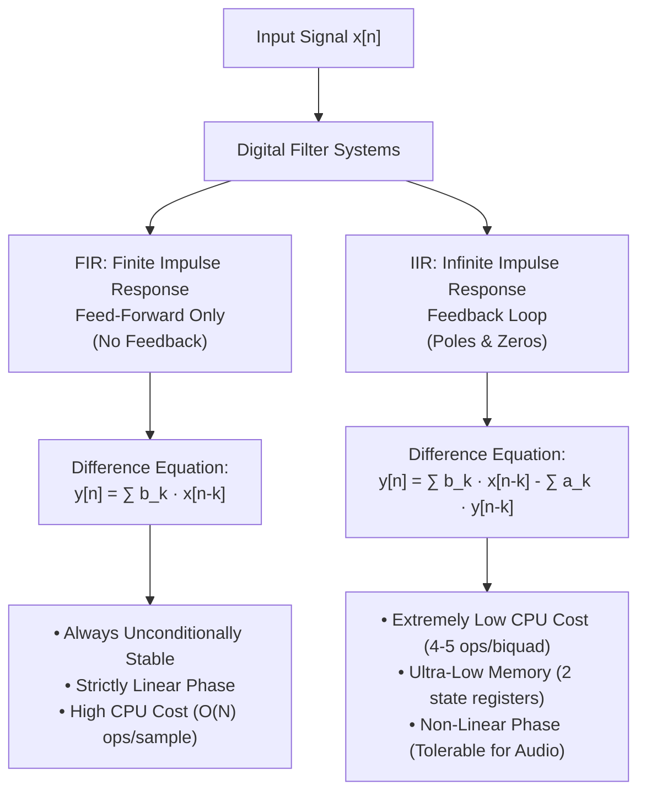

# Digital Filters: FIR vs. IIR and Architecture Rationale

This document provides a theoretical and practical reference on digital filter types, how they function mathematically, their computational complexity, and the architectural rationale for choosing **IIR Biquad filters** in the `fm-analyzer` pipeline.

---

## 1. Filter Fundamentals: FIR vs. IIR

In digital signal processing (DSP), filters are classified into two primary mathematical families based on their impulse response:



---

## 2. FIR Filters (Finite Impulse Response)

An FIR filter computes each output sample as a weighted sum of the current and previous **input** samples only (discrete convolution).

### Direct Form FIR Structure (Tapped Delay Line)

```
x[n] ---> [ z^-1 ] ---> [ z^-1 ] ---> ... ---> [ z^-1 ]
   |         |             |                     |
   v         v             v                     v
 ( b0 )    ( b1 )        ( b2 )                ( bN )
   |         |             |                     |
   +-------->(+)--------->(+)---------> ... ---->(+)-----> y[n]
```

### The Difference Equation
$$y[n] = \sum_{k=0}^{N} b_k \cdot x[n-k] = b_0 x[n] + b_1 x[n-1] + \dots + b_N x[n-N]$$

* **$z^{-1}$ (Unit Delay):** Holds the sample from one discrete time-step in the past ($x[n-1]$).
* **$b_k$ (Filter Taps):** Floating-point weighting coefficients.
* **$N$:** Filter order. The filter uses $N+1$ taps.

### Key Characteristics
1. **Unconditional Stability:** Because there is no feedback loop (no denominator / poles), the output cannot run away or blow up into $\pm\infty$.
2. **Linear Phase:** When coefficients are symmetric ($b_k = b_{N-k}$), all frequency components experience the exact same time delay (constant group delay). This prevents waveform distortion in digital communication pulses (e.g. QAM / PSK symbol shaping).
3. **High Computational Burden:** Creating a steep filter or narrow passband requires hundreds or thousands of taps, requiring hundreds of multiply-accumulate (MAC) operations per incoming sample.

---

## 3. IIR Filters (Infinite Impulse Response)

An IIR filter combines feed-forward taps with **feedback** from previous **output** samples:

### The Difference Equation
$$y[n] = \sum_{k=0}^{M} b_k \cdot x[n-k] - \sum_{k=1}^{N} a_k \cdot y[n-k]$$

Normalized so that $a_0 = 1$:
$$y[n] = b_0 x[n] + b_1 x[n-1] + b_2 x[n-2] - a_1 y[n-1] - a_2 y[n-2]$$

### The Biquad (2nd-Order Section)

In production DSP, instead of storing both past inputs $(x[n - 1], x[n - 2])$ and past outputs $(y[n - 1], y[n - 2])$, modern DSP implementations use Direct Form II Transposed:

- Requires only 2 state variables $(z1, z2)$ instead of 4
- Has vastly superior numerical stability with 32-bit float precision

Given that, high-order IIR filters are broken down into cascaded pairs of second-order filters called **Biquads**:

```
Direct Form II Transposed (2 State Registers: z1, z2):

x[n] -----( b0 )----------------------(+)--------> y[n]
      |                                ^
      |----( b1 )---(+)---[ z^-1 ]-----|
      |              ^        ^
      |              |        | (z1)
      |----( b2 )----+        |
      |                       |
     ---(-a1)-----------------+
     ---(-a2)------------------------[ z^-1 ] (z2)
```

For every input sample $x$:
```c
y  = b0 * x + z1;
z1 = b1 * x - a1 * y + z2;
z2 = b2 * x - a2 * y;
```

---

## 4. Comprehensive Architectural Comparison

| Metric / Property | FIR Filter (e.g. Kaiser / Equiripple) | IIR Filter (e.g. 2nd-Order Biquad) |
| :--- | :--- | :--- |
| **Feedback Loop** | None (Feed-forward only) | Yes (Recursive feedback from past outputs) |
| **Operations Per Sample** | $N$ multiplications, $N-1$ additions ($50\text{–}500+$ ops) | **4 to 5 multiplications, 4 additions** |
| **State Memory Required** | $N$ floats (sliding ring buffer) | **2 floats** (`z1`, `z2`) |
| **CPU Cache Footprint** | Moderate to high; risks cache thrashing | Negligible; state fits entirely in CPU registers |
| **Phase Linearity** | **Perfect linear phase** (constant group delay) | **Non-linear phase** (frequency-dependent group delay) |
| **Stability Risk** | $100\%$ stable (always within bounds) | Conditionally stable (poles must reside inside unit circle) |
| **Filter Steepness / Roll-off** | Requires large tap counts ($N \propto 1/\Delta f$) | High roll-off achievable with very low order |
| **Best Used For** | Pulse shaping, digital symbol recovery, linear phase audio mastering | **Real-time audio, SDR subcarrier separation, PLLs, de-emphasis** |

---

## 5. Quantitative Computational Efficiency Comparison

To understand the order-of-magnitude difference in CPU load, consider the empirical **Fred Harris / Bellanger formula** for required FIR tap count:

$$N_{\text{FIR}} \approx \frac{2}{3} \cdot \frac{f_s}{\Delta f} \cdot \log_{10}\left(\frac{1}{10 \cdot \delta_1 \delta_2}\right)$$

Where:
* $f_s$ is the sampling rate ($250\text{ kSPS}$ on the MPX bus).
* $\Delta f$ is the transition bandwidth.
* $\delta_1, \delta_2$ are the passband ripple and stopband rejection requirements.

### Case Study: Isolating the 19 kHz Stereo Pilot Tone
* Sample Rate ($f_s$): $250\text{ kHz}$
* Center Frequency ($f_0$): $19\text{ kHz}$
* Desired Bandwidth ($\Delta f$): $1\text{ kHz}$ ($Q \approx 20\text{–}30$)

1. **FIR Approach:**
   $$N_{\text{FIR}} \approx \frac{2}{3} \cdot \frac{250\text{ kHz}}{1\text{ kHz}} \cdot \log_{10}(1000) \approx 500 \text{ taps}$$
   * Operations: $500$ multiplications + $500$ additions per sample.
   * Throughput at $250\text{ kSPS}$: **$250\text{ million floating-point operations per second}$ (250 MFLOPS)** for this single filter alone.

2. **IIR Biquad Approach:**
   * Single 2nd-order band-pass Biquad ($Q = 30$).
   * Operations: **$4$ multiplications + $4$ additions** per sample.
   * Throughput at $250\text{ kSPS}$: **$2\text{ MFLOPS}$**.

$$\text{Efficiency Advantage} = \frac{250\text{ MFLOPS}}{2\text{ MFLOPS}} = \mathbf{125\times\text{ faster}}$$

---

## 6. Architectural Rationale: Why `fm-analyzer` Uses IIR Filters

In the `fm-analyzer` real-time SDR pipeline, IIR Biquad filters were chosen for four key reasons:

### 1. Embedded & Low-Power Hardware Compatibility
The SDR receiver is designed to run efficiently not just on high-end desktop CPUs, but also on resource-constrained embedded platforms like Raspberry Pi 3/4 or BeagleBone:
* A multi-tap FIR pipeline at $250\text{ kSPS}$ easily saturates CPU caches and memory buses.
* Cascaded IIR Biquads keep all filter states in local CPU registers (`z1`, `z2`), maximizing compiler SIMD vectorization and cache locality.

### 2. Human Auditory Perception Ignores Mild Phase Distortion
The main disadvantage of IIR filters is **phase non-linearity** (different frequencies experience slightly different phase shifts).
* While phase non-linearity distorts digital constellations (like QAM-64), the human auditory system is notoriously insensitive to absolute phase variations across audible frequencies.
* Broadcast FM audio filtered through a Butterworth or Chebyshev IIR filter sounds pristine to human listeners.

### 3. Native Fit for Subcarrier Separation (Pilot & RDS)
The MPX bus contains narrow subcarriers:
* $19\text{ kHz}$ stereo pilot tone ($Q \approx 30$).
* $57\text{ kHz}$ RDS subcarrier ($Q \approx 15$).

Extracting high-$Q$ resonant peaks with FIR requires massive delay lines, whereas an IIR Biquad band-pass filter naturally models continuous-time analog LC resonators with zero memory overhead.

### 4. Continuity with FM De-Emphasis
The FM de-emphasis filter ($50\mu\text{s}$ or $75\mu\text{s}$) is by definition a 1st-order analog single-pole RC low-pass filter:
$$H(s) = \frac{1}{1 + s\tau}$$
Using an IIR difference equation directly mirrors the exact mathematical physics of the analog transmission standard with minimal computation.
