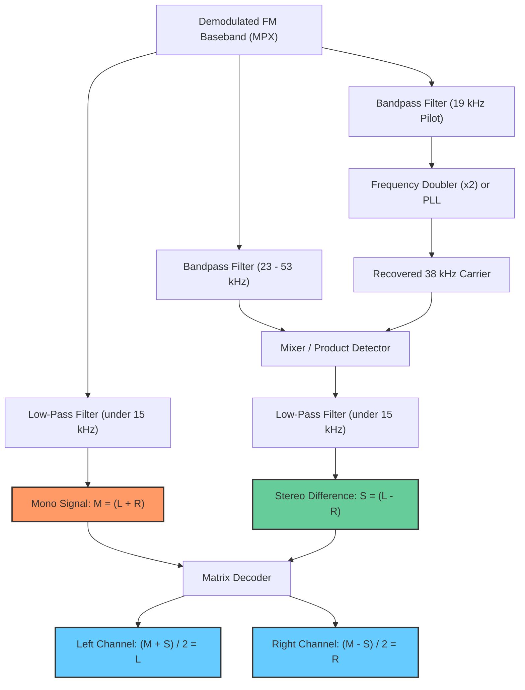

# FAQ: FM Stereo Broadcasting, the 19 kHz Pilot Tone, and the 38 kHz Subcarrier

This document explains how FM stereo broadcasting achieves backward compatibility with mono receivers, the structure of the composite multiplex (MPX) baseband spectrum, and why the receiver doubles a **19 kHz pilot tone** to **38 kHz** to demodulate the stereo difference signal $(L - R)$.

---

## 1. The Backward-Compatibility Problem

In the early 1960s, millions of households owned standard mono FM radios. When stereophonic sound (Left $L$ and Right $R$ audio channels) was introduced, broadcasters could not simply transmit $L$ on one frequency and $R$ on another, as that would break existing receivers and double the required radio frequency spectrum.

Instead, engineers designed an algebraic **matrix encoding scheme**:

$$\text{Mono Channel (Sum): } M = L + R$$
$$\text{Stereo Channel (Difference): } S = L - R$$

* **Mono Receivers:** Only listen to the baseband sum signal ($L + R$). Both ears are blended cleanly into a single mono audio channel.
* **Stereo Receivers:** Receive both $L + R$ and $L - R$, then recover the original stereo channels using simple arithmetic:
  $$\text{Left Ear} = \frac{(L + R) + (L - R)}{2} = \frac{2L}{2} = L$$
  $$\text{Right Ear} = \frac{(L + R) - (L - R)}{2} = \frac{2R}{2} = R$$

---

## 2. The Baseband Spectrum Layout

Human hearing spans roughly **$20\text{ Hz}$ to $15\text{ kHz}$**. Broadcast FM stations allocate $15\text{ kHz}$ of audio bandwidth per channel.

To broadcast both signals simultaneously, the station frequency-division multiplexes them into a single baseband signal called the **Composite MPX Signal**:

```text
Composite FM Baseband Spectrum (MPX):

Power
  ▲
  │   Mono Audio (L + R)               Stereo Difference (L - R)            RDS Data
  │       0 - 15 kHz                     centered at 38 kHz                  57 kHz
  │   ┌───────────────┐        ▲       ┌───────────────────┐                 ┌─────┐
  │   │               │     19 kHz     │                   │                 │     │
──┴───┴───────────────┴────────┴───────┴─────────▲─────────┴─────────────────┴──┴──┴──► Frequency
      0              15       Pilot    23       38        53                    57 kHz
                                       │◄────── 30 kHz ───►│
```

1. **Mono Audio ($L + R$):** Transmitted directly at baseband between **$0\text{ and } 15\text{ kHz}$**.
2. **Stereo Difference ($L - R$):** Modulated onto an ultrasonic subcarrier centered at **$38\text{ kHz}$**. Because audio spans $\pm 15\text{ kHz}$, the $(L - R)$ sidebands occupy:
   $$38\text{ kHz} \pm 15\text{ kHz} = \mathbf{23\text{ kHz to } 53\text{ kHz}}$$

---

## 3. Why Not Transmit a 38 kHz Carrier Wave?

To modulate $(L - R)$ onto 38 kHz, stations use **Double-Sideband Suppressed Carrier (DSB-SC)** amplitude modulation:

$$s_{\text{stereo}}(t) = (L(t) - R(t)) \cdot \cos(2\pi \cdot 38,000 \cdot t)$$

Broadcasting a strong 38 kHz carrier wave directly would:
1. **Waste Power:** A continuous unmodulated 38 kHz carrier consumes substantial transmitter power while conveying zero audio information.
2. **Reduce Modulation Headroom:** Transmitting a carrier tone reduces the maximum frequency deviation available for the actual music.

Therefore, the station suppresses the 38 kHz carrier entirely, transmitting only the sidebands ($23\text{–}53\text{ kHz}$).

### The Receiver Dilemma
To demodulate a DSB-SC signal back to audible frequencies ($0\text{–}15\text{ kHz}$), the receiver must multiply the sidebands by a **locally generated 38 kHz carrier** that matches the transmitter's carrier **frequency and phase with extreme precision**:
* Even a $1\text{ Hz}$ frequency offset causes continuous phase rotation, making the stereo sound field drift from left to right.
* A $90^\circ$ phase error completely nullifies the stereo difference signal, reducing output to mono.

---

## 4. The 19 kHz Pilot Solution

Notice the spectral gap between the mono audio and the stereo subcarrier:
* Mono audio ends at **$15\text{ kHz}$**.
* The stereo subcarrier begins at **$23\text{ kHz}$**.
* The region between $15\text{ kHz}$ and $23\text{ kHz}$ is empty spectrum.

Exactly in the middle of this spectral gap sits **$19\text{ kHz}$** ($38\text{ kHz} / 2 = 19\text{ kHz}$):

* **Above Human Hearing:** $19\text{ kHz}$ is beyond the range of normal adult hearing ($> 15\text{–}17\text{ kHz}$) and is stripped by standard receiver audio filters.
* **Spectral Isolation:** Sitting in the empty $8\text{ kHz}$ guard band, it causes zero interference with mono audio or the stereo subcarrier.
* **Low Power:** Transmitted as a quiet, pure sine wave at $8\text{–}10\%$ of total modulation depth.

---

## 5. Frequency Doubling: Recovering the 38 kHz Carrier

The receiver filters out the pure 19 kHz pilot tone and doubles its frequency using non-linear analog circuits or digital signal processing.

### A. Mathematical Derivation (Double-Angle Trigonometry)

Recall the standard double-angle trigonometric identity:
$$\cos(2\theta) = 2\cos^2(\theta) - 1$$

Rearranging this into the **power-reduction identity** gives:
$$\cos^2(\theta) = \frac{1 + \cos(2\theta)}{2} = \frac{1}{2} + \frac{1}{2}\cos(2\theta)$$

*(Or equivalently for sine: $\sin^2(\theta) = \frac{1}{2} - \frac{1}{2}\cos(2\theta)$).*

When the receiver extracts the $19\text{ kHz}$ pilot tone, the signal has an unknown amplitude $A$ (typically $A \approx 0.08\text{–}0.10$, representing $8\text{–}10\%$ modulation depth):
$$x(t) = A\cos(\theta), \quad \text{where } \theta = 2\pi \cdot 19,000 \cdot t$$

Squaring each sample ($x(t)^2 = x \cdot x$) yields:
$$x^2(t) = A^2 \cos^2(\theta) = \underbrace{\frac{A^2}{2}}_{\text{DC Offset}} + \underbrace{\frac{A^2}{2}\cos(2\pi \cdot \mathbf{38,000} \cdot t)}_{\text{Double-Frequency Carrier (38 kHz)}}$$

### B. Why Naive $2x^2 - 1$ Fails When $A \neq 1.0$

The textbook identity $\cos(2\theta) = 2\cos^2(\theta) - 1$ implicitly assumes a unit amplitude of $A = 1.0$. In a real SDR receiver where $A \approx 0.1$:
$$2x^2 - 1 = 2(0.1\cos\theta)^2 - 1 = 0.01 + 0.01\cos(2\theta) - 1 = \mathbf{-0.99} + 0.01\cos(2\theta)$$
Instead of centering the wave at $0.0$, subtracting a hardcoded $1.0$ introduces a massive $-0.99$ DC bias!

### C. Solving the Unknown Amplitude Problem via Average Energy ($\overline{x^2}$)

Notice that in $x^2(t) = \frac{A^2}{2} + \frac{A^2}{2}\cos(2\theta)$, the $\cos(2\theta)$ term oscillates symmetrically above and below zero (its time-average is $0$). Therefore, the **running average of $x^2(t)$ is literally the DC offset $\frac{A^2}{2}$**:

$$\overline{x^2} = \frac{A^2}{2}$$

We can track $\overline{x^2}$ continuously using a single-pole IIR exponential moving average (EMA) with a $\tau \approx 10\text{ ms}$ time constant:
$$\overline{x^2}[n] = \overline{x^2}[n-1] + \alpha \cdot \left(x[n]^2 - \overline{x^2}[n-1]\right), \quad \alpha = 1 - e^{-\frac{1}{f_s \cdot \tau}}$$

Tracking $\overline{x^2}$ solves **two problems simultaneously**:
1. **Stereo Presence Detection:** If $\overline{x^2}$ exceeds a minimum energy threshold, a $19\text{ kHz}$ pilot tone is present (`is_stereo = true`).
2. **DC Removal & Amplitude Normalization:** Subtracting $\overline{x^2}$ and dividing by $\overline{x^2}$ cancels out $\frac{A^2}{2}$ completely, restoring the exact unit-amplitude double-angle identity regardless of signal strength $A$:

$$\text{carrier}[n] = \frac{x[n]^2 - \overline{x^2}}{\overline{x^2}} = \frac{\frac{A^2}{2}(1 + \cos 2\theta) - \frac{A^2}{2}}{\frac{A^2}{2}} = 2\cos^2(\theta) - 1 = \mathbf{\cos(2\theta)}$$

### D. Alternative Approach: Digital Phase-Locked Loop (DPLL)

Instead of squaring the filtered pilot directly, some receivers use a **Digital Phase-Locked Loop (DPLL)**—a closed-loop feedback system consisting of:
1. **Phase Detector:** Multiplies the incoming $19\text{ kHz}$ pilot by a locally generated sine wave to measure phase error.
2. **Loop Filter (PI Controller):** Smooths the error signal like a mechanical flywheel to track frequency and phase drift.
3. **Numerically Controlled Oscillator (NCO):** Synthesizes a noise-free local $19\text{ kHz}$ wave, $38\text{ kHz}$ stereo carrier ($2\theta$), and $57\text{ kHz}$ RDS carrier ($3\theta$).

---

## 6. Demodulation Pipeline Architecture



---

## 7. A Concrete Numerical Example

Suppose a radio broadcast has a guitar panned hard to the **Left** with silence on the **Right**:
* **Left Channel:** $L = 1.0$
* **Right Channel:** $R = 0.0$

### Step 1: Transmitter Encoding
The transmitter computes:
* **Sum (Mono):** $M = L + R = 1.0 + 0.0 = \mathbf{1.0}$
* **Difference (Stereo):** $S = L - R = 1.0 - 0.0 = \mathbf{1.0}$

It modulates:
1. $1.0$ directly into baseband ($0\text{–}15\text{ kHz}$).
2. $1.0$ onto the 38 kHz subcarrier ($23\text{–}53\text{ kHz}$) using DSB-SC.
3. The $19\text{ kHz}$ pilot tone.

---

### Step 2: Mono Receiver Behavior
A mono receiver's audio low-pass filter eliminates everything above $15\text{ kHz}$:
* The 19 kHz pilot and 38 kHz stereo sidebands are discarded.
* It outputs:
  $$\text{Audio Out} = M = \mathbf{1.0}$$
* The listener hears the guitar at normal volume through their single speaker without distortion.

---

### Step 3: Stereo Receiver Behavior
1. **Extracts Mono Audio:**
   $$M = L + R = 1.0$$
2. **Locks onto 19 kHz Pilot:** Detects stereo presence and illuminates the "STEREO" indicator.
3. **Reconstructs 38 kHz Carrier:** Multiplies the pilot frequency by $2$.
4. **Demodulates the 38 kHz Subcarrier:** Multiplies the $23\text{–}53\text{ kHz}$ band by the recovered 38 kHz carrier and filters $< 15\text{ kHz}$ to obtain:
   $$S = L - R = 1.0$$
5. **Reconstructs Individual Speakers:**
   $$\text{Left Speaker} = \frac{M + S}{2} = \frac{1.0 + 1.0}{2} = \mathbf{1.0} \quad (\text{Guitar plays cleanly on the Left})$$
   $$\text{Right Speaker} = \frac{M - S}{2} = \frac{1.0 - 1.0}{2} = \mathbf{0.0} \quad (\text{Silence on the Right})$$

Stereo separation is fully maintained with zero crosstalk.
